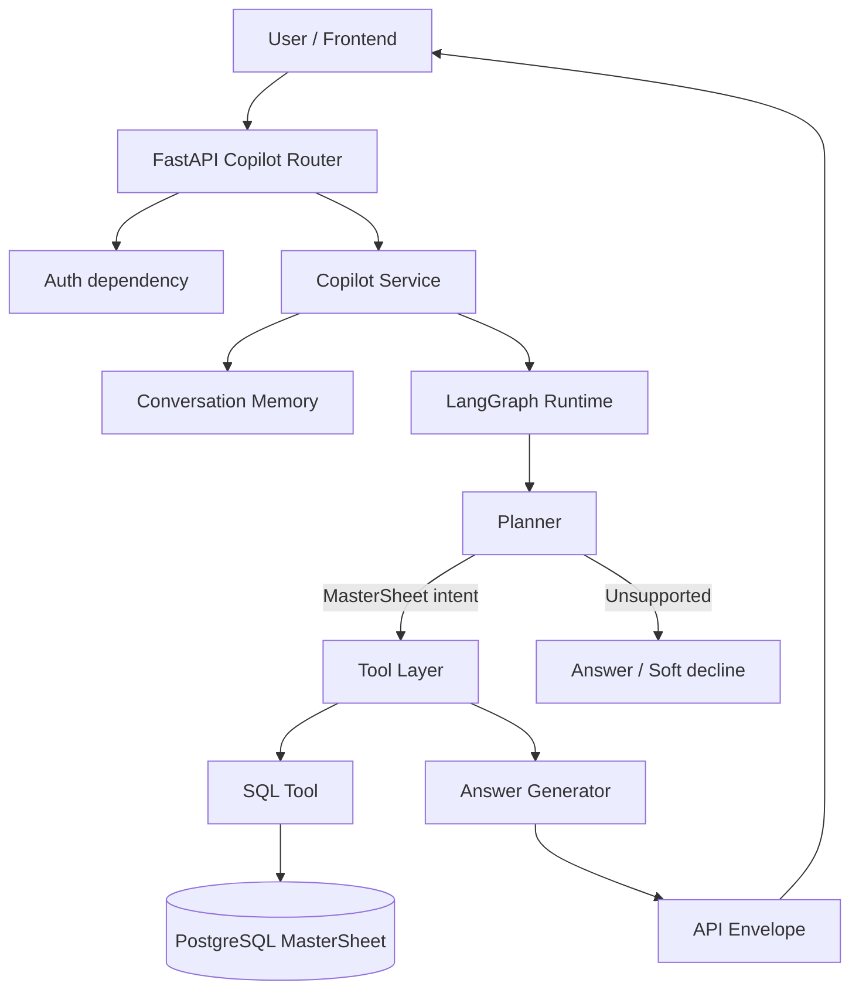
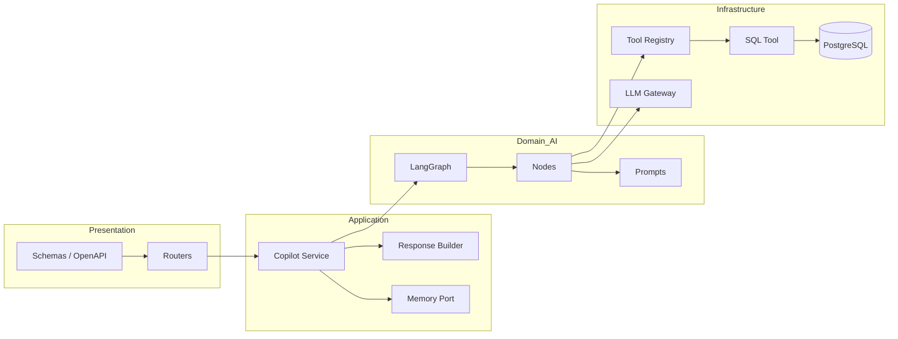
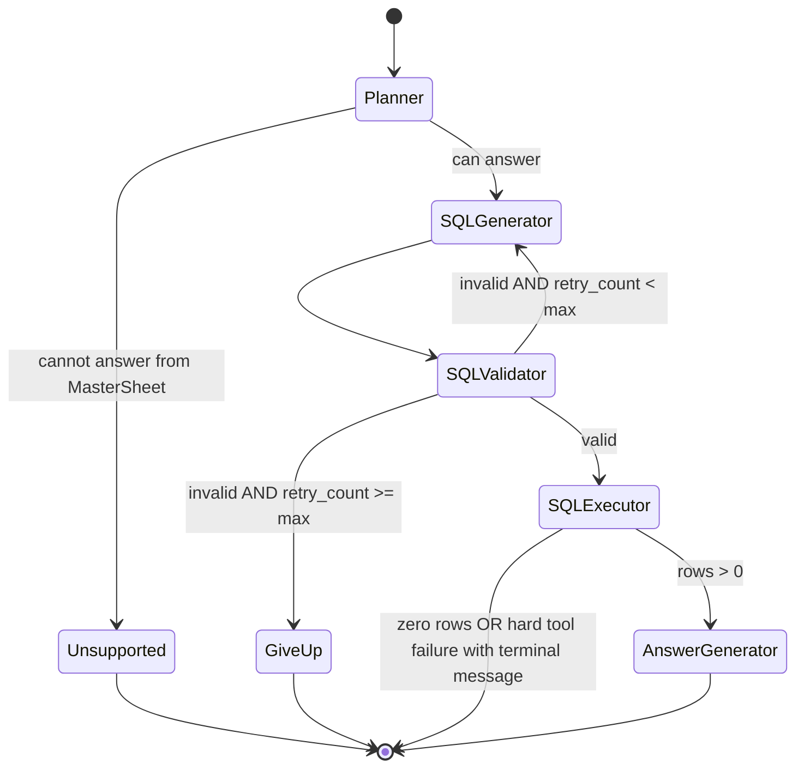
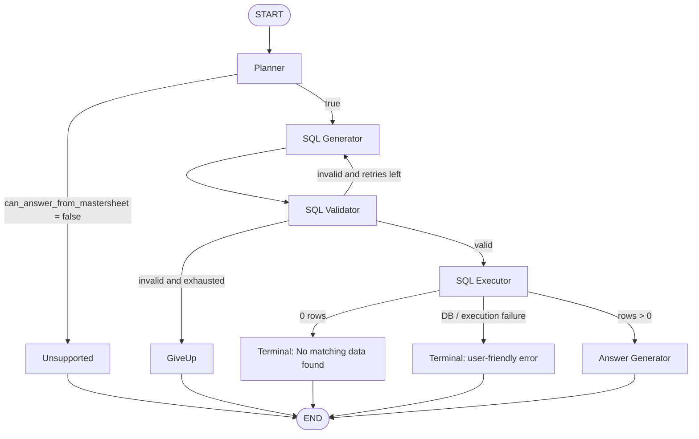
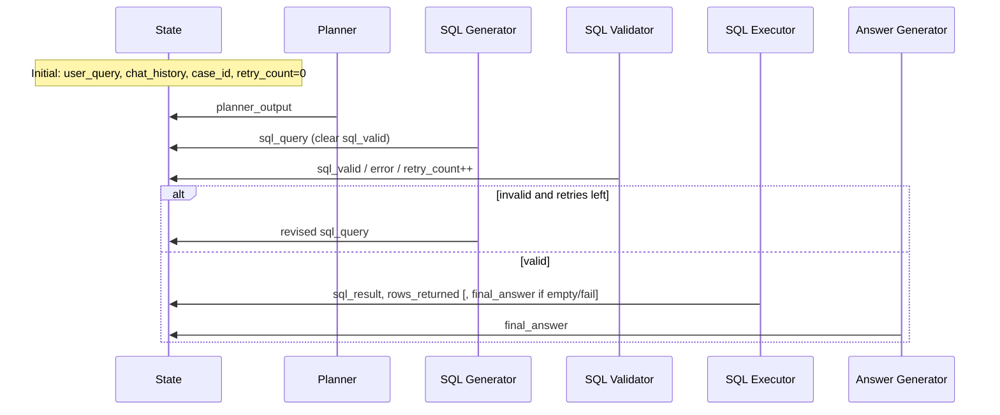
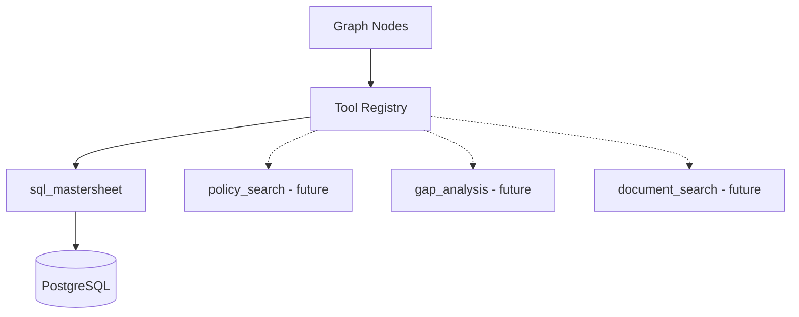
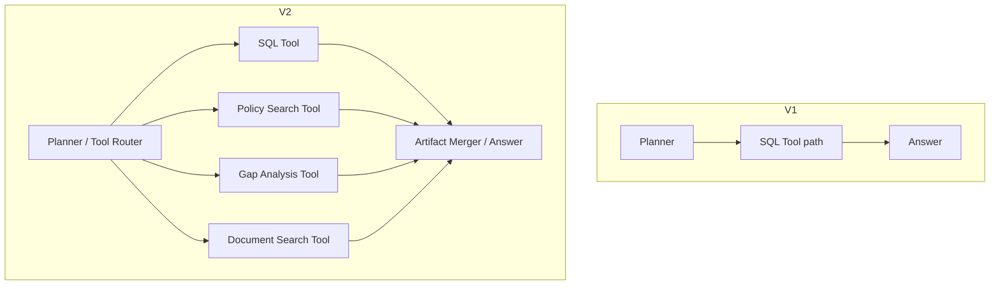

# AI Copilot Architecture Specification

**Product:** Insurance Gap Analysis Platform (Claurix)  
**Component:** AI Copilot — Version 1  
**Status:** Architecture Blueprint (implementation guidance)  
**Audience:** Backend, Frontend, and AI Engineering  

---

## 1. Vision

### 1.1 What the Copilot is

The Copilot is a case-aware, conversational AI assistant embedded in the Insurance Gap Analysis platform. It answers underwriting and commercial questions about active insurance cases by reasoning over structured MasterSheet data stored in PostgreSQL.

Users interact in natural language. They never write SQL, never choose tables, and never navigate raw result grids unless the UI chooses to render artifacts (tables, charts) returned by the API.

Version 1 is intentionally narrow: **one capability, one tool** — natural-language analytics over the MasterSheet via a safe, read-only SQL tool.

### 1.2 Problems it solves

| Problem today | Copilot approach |
| --- | --- |
| Analysts manually scan merged Excel / JSON for premiums and clause statuses | Ask “lowest premium” / “who accepted Terrorism” and get a grounded answer |
| Follow-up questions lose context across screens | Conversation memory + `conversation_id` preserves case-scoped dialogue |
| Ad-hoc SQL against production DB is unsafe and uneven | LLM generates SQL; validator enforces SELECT-only; executor uses platform DB session |
| Frontend would otherwise need N analytics endpoints | One chat contract; tools evolve behind a stable envelope |

### 1.3 Why LangGraph

A linear “prompt → answer” chain is insufficient for production analytics:

- Intermediate validation and retries are first-class control flow.
- Empty results, invalid SQL, and unsupported intents need different terminal paths.
- Future multi-tool routing requires a planner that can choose among tools without rewriting the HTTP layer.

LangGraph provides explicit **state**, **nodes**, **conditional edges**, and **retry loops** that map cleanly to operational requirements (observability, timeouts, max retries, tool isolation).

### 1.4 Why the system is tool-based

The Copilot is an **orchestrator**, not a monolith. Capabilities are tools with contracts:

- Inputs / outputs typed and testable in isolation
- Side effects (DB, search, file IO) confined to tools
- Graph nodes decide *when* to call tools; tools decide *how*

Version 1 registers a single tool: **SQL Tool** (`sql_mastersheet`). Version 2+ adds tools without changing the public API envelope — only planner routing and tool registry entries grow.

---

## 2. High-Level AI Architecture

### 2.1 Control flow (logical)



### 2.2 Platform integration (non-negotiables)

The Copilot **integrates into** the existing FastAPI application. It must:

| Reuse | Do not create |
| --- | --- |
| Existing FastAPI app entrypoint | Second FastAPI process |
| Existing auth dependency / middleware pattern | Parallel auth system |
| Existing PostgreSQL session / connection layer | Separate connection pool “for AI only” |
| Existing settings / logging | Ad-hoc `print` / hard-coded secrets |
| Existing case context conventions (`case_id`) | Global cross-tenant queries by default |

### 2.3 Layering



---

## 3. LangGraph Design

### 3.1 Topology (Version 1)



Equivalent flowchart:



### 3.2 Retry policy

| Parameter | Default | Rationale |
| --- | --- | --- |
| `max_sql_retries` | `3` | Bounds LLM cost / latency; enough for format fixes |
| What increments retry | Failed **validation** only | Execution failures are not “fix SQL and hope” by default |
| What is fed back | Prior SQL + validation error string | Enables corrective generation |

Validator failures loop to SQL Generator. After max retries → GiveUp terminal node with structured error mapping at the API layer.

### 3.3 Node catalogue

#### 3.3.1 Planner

| Aspect | Specification |
| --- | --- |
| **Purpose** | Interpret user intent; decide MasterSheet suitability; produce structured plan. **Never** emit SQL or final business answers. |
| **Inputs** | `user_query`, `chat_history`, `case_id` |
| **Outputs** | `planner_output` (JSON object) |
| **Failure conditions** | LLM timeout / malformed JSON → use safe fallback plan or route to soft unsupported / internal error per product policy |
| **Retry behaviour** | No graph-level retry in V1; service may surface `LLM_TIMEOUT` |

**Expected `planner_output` shape (logical):**

- `intent`: e.g. `premium_analysis` | `clause_lookup` | `acceptance_analytics` | `comparison` | `general_mastersheet` | `unsupported`
- `requires_reasoning`: boolean
- `output_type`: `table` | `scalar` | `list` | `narrative`
- `can_answer_from_mastersheet`: boolean
- `notes`: short non-SQL planning note

#### 3.3.2 SQL Generator

| Aspect | Specification |
| --- | --- |
| **Purpose** | Translate question + plan + schema + history into **one** PostgreSQL read query |
| **Inputs** | `user_query`, `planner_output`, `chat_history`, `case_id`, schema prompt, optional `sql_query` + `error` on retry |
| **Outputs** | `sql_query` (string, SQL only) |
| **Failure conditions** | Non-SQL prose, invented columns, write statements (caught later by validator) |
| **Retry behaviour** | Re-entered from validator with error context |

**Hard rules (product):** SELECT / WITH only; respect MasterSheet columns; apply case filter when `case_id` present; prefer `ILIKE` for fuzzy text; default row limits for listings.

#### 3.3.3 SQL Validator

| Aspect | Specification |
| --- | --- |
| **Purpose** | Deterministic safety gate before any DB IO |
| **Inputs** | `sql_query`, `retry_count` |
| **Outputs** | `sql_valid`, updated `retry_count`, `error` reason if invalid |
| **Failure conditions** | Empty SQL; multiple statements; forbidden keywords (INSERT/UPDATE/DELETE/DDL/…); injection patterns; dangerous functions |
| **Retry behaviour** | If invalid and `retry_count < max` → edge back to SQL Generator; else → GiveUp |

Validator is **code**, not an LLM. It must be unit-tested exhaustively.

#### 3.3.4 SQL Executor

| Aspect | Specification |
| --- | --- |
| **Purpose** | Invoke SQL Tool; normalize results into graph state |
| **Inputs** | `sql_query` (validated) |
| **Outputs** | `sql_result` (tabular records), `rows_returned`, optional terminal `final_answer` on empty/hard failure, `error` |
| **Failure conditions** | DB unavailable; SQL syntax runtime error; connection failures |
| **Retry behaviour** | No automatic regenerate loop in V1 (avoids amplifying bad queries). Map to user-safe message + API error code. |

**Empty result policy:** set `final_answer = "No matching data found."` and skip Answer Generator (or short-circuit equivalently).

#### 3.3.5 Answer Generator

| Aspect | Specification |
| --- | --- |
| **Purpose** | Produce business-facing natural language / markdown from **only** the SQL result + question |
| **Inputs** | `user_query`, `sql_query`, `sql_result` |
| **Outputs** | `final_answer` |
| **Failure conditions** | LLM failure → fallback summary of row counts / generic apology without inventing numbers |
| **Retry behaviour** | None in V1 |

**Guardrails:** never invent premiums or statuses; preserve numeric fidelity; summarize large result sets; support markdown tables when appropriate.

#### 3.3.6 Terminal helper nodes (implementation detail)

| Node | Role |
| --- | --- |
| Unsupported | Fixed decline when planner rejects MasterSheet scope |
| GiveUp | Fixed message after exhausted SQL validation retries |

These may be explicit graph nodes or equivalent terminal branches; behaviour is normative.

---

## 4. State Design

State is a **TypedDict** (or equivalent typed structure) passed through the graph. Keep it minimal: only fields required for control flow, tool IO, and answer synthesis.

### 4.1 Field catalogue

| Field | Type (logical) | Why it exists |
| --- | --- | --- |
| `user_query` | `str` | Immutable user turn text for all prompts |
| `chat_history` | `list[{role, content}]` | Short-term dialogue for follow-ups (“only active ones”) |
| `case_id` | `str \| null` | Case scope; injected into SQL generation context |
| `planner_output` | `dict` | Structured intent for routing and metadata |
| `sql_query` | `str` | Current candidate SQL |
| `sql_valid` | `bool` | Validator outcome for conditional edges |
| `sql_result` | `list[dict] \| null` | Executor payload for Answer Generator / artifacts |
| `rows_returned` | `int` | Fast path for empty checks and API metadata |
| `retry_count` | `int` | Bounds validator → generator loop |
| `final_answer` | `str` | Terminal natural-language answer |
| `error` | `str \| null` | Last machine-oriented error (validation / tool); never raw stack to client |

### 4.2 State transitions by node



| After node | Typical mutations |
| --- | --- |
| Planner | Sets `planner_output`; resets/keeps `retry_count` |
| SQL Generator | Sets `sql_query`; sets `sql_valid=false` pending validation |
| SQL Validator | Sets `sql_valid`; on failure increments `retry_count`, sets `error` |
| SQL Executor | Sets `sql_result`, `rows_returned`; may set terminal `final_answer` + `error` |
| Answer Generator | Sets `final_answer`; clears soft `error` when successful |

**Anti-pattern:** storing full LLM transcripts, prompt templates, or DB credentials in state.

---

## 5. Tool Architecture

### 5.1 Tool registry

A process-level registry maps tool names → callables. Nodes resolve tools by name (`sql_mastersheet`), never by importing infrastructure drivers directly.



### 5.2 SQL Tool (`sql_mastersheet`)

| Aspect | Specification |
| --- | --- |
| **Responsibilities** | Re-validate SQL; execute read-only query via platform DB session; return `pandas.DataFrame` (or equivalent tabular structure) |
| **Inputs** | `sql: str` |
| **Outputs** | Tabular result set |
| **Errors** | Typed failures: rejected by guard; database unavailable; execution failure (wrap underlying DB exceptions — never leak connection strings / stack traces to API clients) |
| **Non-responsibilities** | Prompting; planning; answer prose; authZ beyond using the shared session |

**Invariant:** LangGraph nodes **must not** open PostgreSQL connections themselves. All MasterSheet IO goes through the SQL Tool.

### 5.3 Future tool plug-in model

To add a tool in Version 2+:

1. Implement tool function with clear IO contract and error taxonomy.
2. Register in the tool registry.
3. Extend Planner outputs with a `tool` / `tools[]` choice (or dedicated routing field).
4. Add graph branch(es) after Planner (or a Tool Router node).
5. Map tool outputs into **API artifacts** in the response builder.

No change to `POST /api/copilot/chat` envelope shape is required.

---

## 6. Prompt Strategy

Prompts live **outside** node code (e.g. `prompts/*.md`), loaded and rendered at runtime. This enables prompt iteration without graph refactors and keeps diffs reviewable by domain experts.

### 6.1 Planner prompt

| Aspect | Guidance |
| --- | --- |
| **Purpose** | Intent classification + MasterSheet feasibility |
| **Responsibilities** | Emit JSON plan only |
| **Inputs** | User query, chat history, case id |
| **Outputs** | JSON object (intent, flags, notes) |
| **Guardrails** | No SQL; no final answer; unsupported when out of scope |
| **Format** | Strict JSON; prefer model JSON mode when available |

### 6.2 SQL Generator prompt

| Aspect | Guidance |
| --- | --- |
| **Purpose** | Produce a single safe SELECT |
| **Responsibilities** | Use provided schema; honor case scope; follow listing limits |
| **Inputs** | Schema text, planner JSON, history, query, prior SQL + validation error on retry |
| **Outputs** | Raw SQL only (no markdown fences preferred; strip if present) |
| **Guardrails** | Column allowlist; no DDL/DML; no invented relations |
| **Format** | Single statement string |

### 6.3 Answer Generator prompt

| Aspect | Guidance |
| --- | --- |
| **Purpose** | Business narrative grounded in result rows |
| **Responsibilities** | Summarize / explain; optional markdown table for compactness |
| **Inputs** | User query, SQL (for traceability in prompt only), JSON records |
| **Outputs** | Natural language / markdown |
| **Guardrails** | No hallucination of numbers/statuses; empty → explicit no-data wording if reached |
| **Format** | Free text / markdown |

**Note:** SQL is included in the answer prompt for grounding, not for frontend exposure. Public APIs hide SQL unless debug mode is enabled.

---

## 7. Conversation Memory

### 7.1 Short-term memory (V1)

| Concern | Design |
| --- | --- |
| Identity | `conversation_id` (UUID). Created server-side if client omits it |
| Contents | Ordered turns `{role: user\|assistant, content}` |
| Window | Last *N* turns (configurable, e.g. 6 user/assistant pairs) |
| Scope | Process-local store acceptable for V1 single-instance / sticky sessions |

### 7.2 Follow-up behaviour

Example:

1. User: “Show Tata AIG policies.”
2. User: “Only active ones.”

History is injected into Planner and SQL Generator prompts so ellipsis resolution (“ones”) can bind to Tata AIG / prior filters. Case id remains independently supplied every request (frontend responsibility) so memory never becomes the sole tenancy boundary.

### 7.3 Evolution path

Define a **Memory Port** interface:

- `ensure_conversation_id`
- `get_history`
- `append`

V1: in-memory implementation.  
Later: Redis (TTL, multi-instance) or PostgreSQL conversation tables — **swap implementation without changing graph nodes**.

---

## 8. API Contract

Public HTTP contracts hide LangGraph. Frontend integrates only with the Copilot router.

### 8.1 Synchronous chat

`POST /api/copilot/chat`

**Request**

```json
{
  "message": "Which insurer quoted the lowest premium?",
  "conversation_id": null,
  "case_id": "101",
  "debug": false
}
```

| Field | Required | Notes |
| --- | --- | --- |
| `message` | Yes | Non-empty user text |
| `conversation_id` | No | Null/omit on first turn |
| `case_id` | Recommended | Also accept `X-Case-Id` header |
| `debug` | No | Default `false` |

**Response envelope (normative)**

```json
{
  "success": true,
  "conversation_id": "…",
  "message_id": "msg_…",
  "response": {
    "type": "text | markdown | table | chart",
    "content": "…"
  },
  "artifacts": [],
  "suggestions": [],
  "metadata": {},
  "error": null
}
```

### 8.2 Artifacts

Extensible tool outputs. V1 SQL success typically emits a `table` artifact:

```json
{
  "id": "art_table_…",
  "type": "table",
  "title": "MasterSheet results",
  "data": { "columns": ["…"], "rows": [ { } ] },
  "schema_version": "1.0"
}
```

Allowed types: `table` | `chart` | `markdown` | `json` | `file` (file reserved for future exports).

**Rule:** New tools add artifacts — they do **not** add new top-level envelope keys.

### 8.3 Suggestions

Optional follow-up chips: `{ "label": "…", "message": "…" }`. Frontend may prefills `message` on click.

### 8.4 Metadata

Always present at a high level:

- `intent`, `execution_time`, `rows_returned`, `retries`, `case_id`, `tools_used`

When `debug=true`, nest under `metadata.debug` only:

- `planner_output`
- `generated_sql`
- `execution_time`
- `retry_count`

Never place SQL at the top level of the production response.

### 8.5 Errors

On hard failures: `success=false` and:

```json
{
  "error": {
    "code": "DATABASE_UNAVAILABLE",
    "message": "User-safe message",
    "details": null
  }
}
```

Suggested codes: `VALIDATION_ERROR`, `UNAUTHORIZED`, `UNSUPPORTED_QUERY`, `SQL_GENERATION_FAILED`, `SQL_EXECUTION_FAILED`, `DATABASE_UNAVAILABLE`, `EMPTY_RESULT` (reserved), `LLM_TIMEOUT`, `INTERNAL_ERROR`.

Empty MasterSheet matches remain **soft success** with content “No matching data found.” (product choice for simpler empty-state UX).

### 8.6 Streaming

`POST /api/copilot/chat/stream` — `text/event-stream`

Each event payload:

```json
{
  "event": "planning | tool_call | tool_result | answer_chunk | completed | error",
  "conversation_id": "…",
  "message_id": "…",
  "data": { }
}
```

| Event | Role |
| --- | --- |
| `planning` | Planner started / completed |
| `tool_call` | Tool invocation progress (e.g. SQL generating / running) |
| `tool_result` | Tool finished (e.g. `rows_returned`) |
| `answer_chunk` | Incremental answer text |
| `error` | Structured failure mid-stream |
| `completed` | Final event; `data.envelope` = full sync envelope (source of truth) |

Clients must ignore unknown future event types.

### 8.7 Auth

Reuse platform auth dependency. When auth is disabled in an environment, document the passthrough behaviour explicitly for that environment — do not invent a second auth model.

---

## 9. Extensibility

### 9.1 Version 1 vs Version 2



### 9.2 What stays stable

- HTTP envelope (`success`, `message_id`, `response`, `artifacts`, …)
- SSE event vocabulary (additive only)
- Memory port
- Tool registry pattern
- Prompt isolation
- SELECT-only discipline for any SQL-bearing tool

### 9.3 What changes when adding a tool

- Registry entry
- Planner schema (`tool` choice)
- One or more graph nodes / conditional edges
- Response builder mapping from tool payload → `Artifact`

The frontend continues to render `response` + `artifacts` without knowing LangGraph node names.

---

## 10. Folder Structure

Recommended package layout under the existing backend:

```text
backend/copilot/
├── graph/
│   ├── state.py          # CopilotState TypedDict
│   ├── nodes.py          # Node callables
│   ├── routing.py        # Conditional edge functions
│   └── builder.py        # compile() graph factory
├── tools/
│   ├── registry.py       # Tool registration / lookup
│   └── sql_tool.py       # MasterSheet SQL execution
├── prompts/
│   ├── planner.md
│   ├── sql_generator.md
│   └── answer_generator.md
├── services/
│   ├── copilot_service.py    # Orchestrates memory + graph + envelope
│   ├── memory.py             # Memory port + V1 implementation
│   └── response_builder.py   # Graph result → API envelope
├── routers/
│   └── copilot_router.py     # /api/copilot/* only
├── schemas/
│   └── chat.py               # Pydantic request/response/SSE models
├── schema/
│   └── mastersheet.*         # Column contract / DDL reference for prompts
├── models/                   # Optional domain DTOs (non-ORM)
└── utils/
    ├── prompt_loader.py
    └── sql_guard.py          # Deterministic SQL validation
```

| Folder | Responsibility |
| --- | --- |
| `graph/` | Pure orchestration; no FastAPI; no raw DB drivers |
| `tools/` | Side-effecting capabilities behind stable names |
| `prompts/` | Human-editable prompt assets |
| `services/` | Application use-cases; DI-friendly facades |
| `routers/` | HTTP adapters only |
| `schemas/` | OpenAPI / validation contracts for frontend |
| `schema/` | MasterSheet physical/logical contract for SQL generation |
| `utils/` | Shared pure helpers (loading, guards) |

Mount the router from the existing `main` application module. Do not create a second app.

---

## 11. Engineering Principles

| Principle | Why it matters here |
| --- | --- |
| **Single Responsibility** | Nodes plan *or* generate *or* validate *or* execute *or* narrate — mixed duties create untestable blobs |
| **Tool-first architecture** | Side effects stay swappable; graph stays a router of decisions |
| **Stateless nodes** | Nodes are pure functions of state (+ injected deps); enables replay and unit tests |
| **Reusable tools** | SQL Tool usable from jobs / admin scripts later without LangGraph |
| **Dependency Injection** | DB session, memory, LLM gateway injected — not hard-wired singletons in nodes long-term |
| **Prompt isolation** | Product/legal can revise prompts without touching orchestration code |
| **Type safety** | Typed state + Pydantic envelopes catch contract drift early |
| **Production logging** | Log query (redacted if needed), intent, SQL (secure logs only), latency, rows, retries — never secrets |
| **Error handling** | Map all failures to stable error codes; never return stack traces to browsers |
| **Testing strategy** | Unit: sql_guard, response_builder, routing. Integration: graph with mocked LLM/DB. Contract: OpenAPI envelope fixtures for frontend |

---

## 12. Design Decisions (Architecture Decision Records)

### ADR-001 — LangGraph instead of a simple chain

- **Decision:** Use LangGraph for Copilot orchestration.
- **Context:** Need retries, branching, empty-result short-circuit, future multi-tool routing.
- **Trade-offs:** Higher initial complexity vs. chains; gains explicit control flow and observability.
- **Consequences:** Engineers reason in graphs; streaming maps to node updates.

### ADR-002 — Explicit Planner node

- **Decision:** Separate planning from SQL generation.
- **Context:** Unsupported questions must fail closed without hitting the database.
- **Trade-offs:** Extra LLM call / latency; clearer routing and metadata (`intent`).
- **Consequences:** Planner JSON becomes the extension point for tool choice in V2.

### ADR-003 — Isolated SQL Tool

- **Decision:** All PostgreSQL access through `sql_mastersheet`.
- **Context:** Prevent connection sprawl and keep safety checks centralized.
- **Trade-offs:** Indirection; stronger security and test seams.
- **Consequences:** Future analytics jobs can reuse the same tool.

### ADR-004 — Externalized prompts

- **Decision:** Store prompts as markdown assets, not string literals in nodes.
- **Context:** Rapid prompt iteration by AI/domain owners.
- **Trade-offs:** Runtime file dependency; clearer reviews and environment overlays later.
- **Consequences:** Nodes render templates; CI can lint required placeholders.

### ADR-005 — Minimal graph state

- **Decision:** Keep only fields required for control and answers.
- **Context:** Large state invites accidental PII retention and serialization cost.
- **Trade-offs:** Occasional recomputation; safer memory profile.
- **Consequences:** Artifacts for UI are built at the service/response layer, not stuffed wholesale into graph state beyond `sql_result`.

### ADR-006 — APIs hide LangGraph internals

- **Decision:** Public contract is the envelope + SSE events only.
- **Context:** Frontend must not couple to node names or library versions.
- **Trade-offs:** Mapping layer required; enables backend refactors without UI breaks.
- **Consequences:** Debug information is nested and optional.

### ADR-007 — Frontend never calls tools directly

- **Decision:** Browsers talk only to Copilot HTTP APIs.
- **Context:** Tools may use privileged DB credentials and internal schemas.
- **Trade-offs:** All UX features go through chat/stream; stronger security boundary.
- **Consequences:** Artifacts are the sanctioned channel for rich UI (tables/charts/files).

### ADR-008 — Case scope is request-provided

- **Decision:** `case_id` supplied per request (body/header), not inferred solely from memory.
- **Context:** Tenancy / authorization must be explicit.
- **Trade-offs:** Frontend must always send case context; prevents cross-case leakage via sticky history.

### ADR-009 — Validation retries, not execution retries

- **Decision:** Auto-retry only for deterministic SQL validation failures.
- **Context:** Blindly regenerating after DB errors can amplify load and obscure root causes.
- **Trade-offs:** Some transient DB errors need manual retry at UI; safer default.

---

## Appendix A — MasterSheet contract (logical)

Version 1 SQL generation assumes a logical table (name configurable) with columns such as:

`case_id`, `insurer`, `policy`, `premium`, `clause`, `clause_remarks`, `acceptance_status`, `deviation`, `remarks`, `coverage`, `policy_metadata`, `sum_insured`

Physical naming may differ; the schema prompt asset is the source of truth for the SQL Generator.

---

## Appendix B — Implementation sequencing (for engineers)

1. Wire router + Pydantic contracts (no graph).  
2. Implement `sql_guard` + SQL Tool against platform DB.  
3. Implement graph nodes with mocked LLM.  
4. Connect LLM gateway; add prompts.  
5. Response builder + artifacts.  
6. SSE streaming.  
7. Hardening: auth, logging, load tests, prompt eval harness.

This document is the normative architecture for Copilot V1. Implementation PRs should cite the relevant section/ADR when diverging, and update this specification in the same change set.
