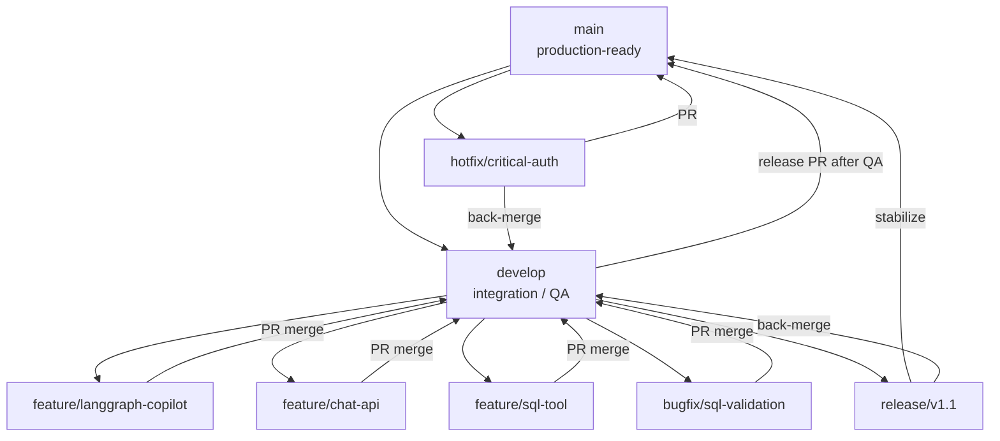
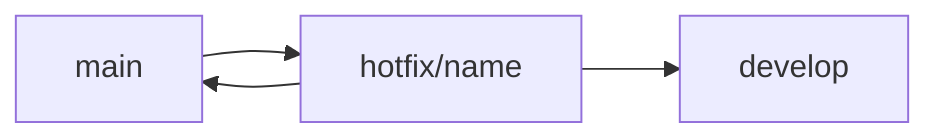
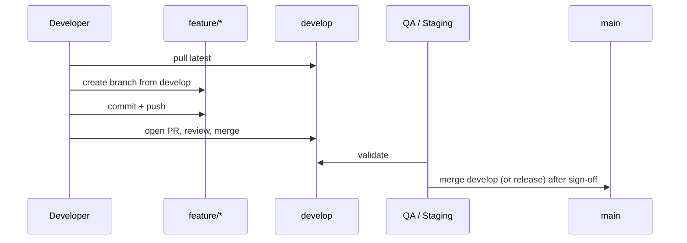

# Git Workflow & Branching Strategy

**Product:** Insurance Gap Analysis Platform (Claurix)  
**Audience:** Backend, Frontend, and AI Engineering  
**Status:** Internal engineering standard  

This document defines how we branch, review, and release code. All contributors are expected to follow it unless an exception is approved by tech lead.

---

## 1. Goals

The workflow must support:

- Multiple engineers shipping in parallel (backend, frontend, AI)
- Frequent integration without destabilizing production
- Safe hotfixes when production breaks
- Clear ownership of AI capabilities (Copilot, RAG, Gap Analysis, etc.)
- Reviewable pull requests with focused diffs

We optimize for **stability of `main`**, **continuous integration on `develop`**, and **isolated feature delivery**.

---

## 2. Branching Model Overview



**Summary flow**

```text
main
  └── develop
        └── feature/*  (and bugfix/*)
              └── merge → develop
                    └── after QA → merge → main
```

---

## 3. Long-Lived Branches

### 3.1 `main`

| Rule | Detail |
| --- | --- |
| **Purpose** | Production-ready code only |
| **Stability** | Always deployable |
| **Direct commits** | **Forbidden** |
| **Direct pushes** | **Forbidden** |
| **Merge source** | Prefer merges from `develop` (or `release/*` / `hotfix/*` when applicable) |

`main` reflects what is (or is about to be) in production. Treat every commit on `main` as a release candidate.

### 3.2 `develop`

| Rule | Detail |
| --- | --- |
| **Purpose** | Integration branch for completed work |
| **Usage** | Features and bugfixes merge here first |
| **QA** | Primary branch for staging / QA validation |
| **Direct feature work** | **Forbidden** — always use a feature/bugfix branch |
| **Direct pushes** | **Forbidden** — PR only |

`develop` may be ahead of `main` and occasionally broken for short periods during integration, but it must be recovered quickly. Do not treat `develop` as a personal workspace.

---

## 4. Feature Branches

Every feature gets its own branch.

### 4.1 Naming

```text
feature/<feature-name>
```

Use lowercase kebab-case. Prefer capability names over ticket-only names (ticket IDs may be appended if useful).

**Examples**

```text
feature/langgraph-copilot
feature/chat-api
feature/sql-tool
feature/policy-rag
feature/gap-analysis
feature/report-generator
feature/premium-analytics
feature/frontend-chat
feature/document-search
feature/recommendation-engine
```

### 4.2 Lifecycle

1. Create from latest `develop`.
2. Implement and push.
3. Open PR → `develop`.
4. After merge, delete the remote feature branch (optional local cleanup).

```text
feature/*  →  develop  →  (QA)  →  main
```

### 4.3 Scope discipline

One feature branch ≈ one reviewable capability. Avoid “mega branches” that mix Copilot + RAG + frontend redesign. Large epics should be split into sequenced feature branches.

---

## 5. Bug Fixes

### 5.1 Naming

```text
bugfix/<bug-name>
```

**Examples**

```text
bugfix/sql-validation
bugfix/chat-memory
bugfix/login
bugfix/premium-extract-parse
```

### 5.2 Base branch

- Default: branch from `develop`, PR back to `develop`.
- If the bug is production-only and urgent, use **hotfix** instead (see below).

---

## 6. Hotfixes

Production emergencies that cannot wait for the normal `develop` → `main` cycle.

### 6.1 Naming

```text
hotfix/<name>
```

**Examples**

```text
hotfix/auth-token-expiry
hotfix/copilot-sql-injection-guard
hotfix/upload-crash-on-empty-file
```

### 6.2 Lifecycle

1. Branch from **`main`**.
2. Apply the minimal fix.
3. Open PR → **`main`** (expedited review allowed).
4. **Back-merge** the same fix into **`develop`** immediately (PR or merge), so the fix is not lost on the next release.



Hotfixes must stay small. Feature work does not belong on a hotfix branch.

---

## 7. Release Branches

Use for larger, planned releases that need a stabilization window (regression testing, version bumps, release notes) without freezing all of `develop`.

### 7.1 Naming

```text
release/v1.0
release/v1.1
release/v2.0-copilot
```

### 7.2 Lifecycle

1. Cut `release/vX.Y` from `develop` when feature-complete for that release.
2. Only bugfixes, docs, and release chores land on the release branch.
3. Merge `release/vX.Y` → `main` when ready to ship.
4. Back-merge `release/vX.Y` → `develop`.

For small ships, merging `develop` → `main` after QA is acceptable without a release branch. Use release branches when stabilization would otherwise block ongoing feature integration on `develop`.

---

## 8. Pull Request Rules

| Rule | Requirement |
| --- | --- |
| PR required | Every feature, bugfix, hotfix, and release merge goes through a Pull Request |
| No direct push to `main` | Enforced by process (and branch protection when configured) |
| No direct push to `develop` | Same |
| Code review | At least **one** approving review before merge |
| CI | All required checks must be green before merge |
| Conflicts | Resolve in the **source** branch (usually the feature branch) **before** requesting final review / merge |
| Description | PR must state intent, test plan, and risk (especially for AI/prompt/SQL changes) |
| Size | Prefer small PRs; split large AI epics |

### 8.1 Suggested PR title style

Align with Conventional Commits when practical:

```text
feat: add LangGraph planner node
fix: handle empty SQL result in copilot executor
docs: update copilot architecture
```

### 8.2 Merge method

Prefer **squash merge** for feature branches into `develop` to keep history readable, unless the team explicitly wants full commit history for a given change. Hotfixes to `main` may use merge commits for clearer audit trails.

---

## 9. Commit Message Convention

Use [Conventional Commits](https://www.conventionalcommits.org/).

### 9.1 Format

```text
<type>(optional-scope): <short summary>

[optional body]
```

### 9.2 Common types

| Type | Use for |
| --- | --- |
| `feat` | New user-facing or API capability |
| `fix` | Bug fix |
| `refactor` | Internal restructuring without behaviour change |
| `docs` | Documentation only |
| `test` | Tests only |
| `chore` | Tooling, deps, CI, non-product chores |
| `perf` | Performance improvement |
| `build` | Build system / packaging |

### 9.3 Examples

```text
feat: add LangGraph planner node
feat: implement SQL validation
fix: handle empty SQL result
fix: improve retry logic
refactor: extract SQL tool service
docs: update copilot architecture
test: add planner unit tests
chore: update dependencies
```

### 9.4 AI-specific guidance

- Prompt-only changes: prefer `feat(copilot):` or `fix(copilot):` with a clear note that prompts changed.
- Do not bury schema/API contract changes inside unrelated refactors.
- Never commit secrets, local `.env` values, or production data dumps.

---

## 10. Standard Development Workflow

Recommended day-to-day loop:

1. **Update local integration branch**
   ```bash
   git checkout develop
   git pull origin develop
   ```
2. **Create a feature branch**
   ```bash
   git checkout -b feature/<feature-name>
   ```
3. **Implement** the feature (keep commits focused).
4. **Commit** using Conventional Commits.
5. **Push** the feature branch
   ```bash
   git push -u origin feature/<feature-name>
   ```
6. **Open a Pull Request** targeting `develop`.
7. **Address review comments**; keep CI green.
8. **Merge** into `develop` (after approval).
9. **QA** validates on the environment tracking `develop` (or a release candidate).
10. **Promote to production** by merging `develop` → `main` (or via `release/*`), then deploy from `main`.



---

## 11. AI Feature Development Strategy

This platform will accumulate many AI capabilities. Treat each capability as a **bounded feature branch**, not as one permanent “AI branch.”

### 11.1 Recommended capability branches (roadmap examples)

```text
feature/langgraph-copilot
feature/sql-tool
feature/chat-api
feature/chat-memory
feature/policy-rag
feature/document-search
feature/gap-analysis
feature/recommendation-engine
feature/report-generation
feature/analytics-engine
```

### 11.2 Why isolate AI capabilities

| Benefit | Explanation |
| --- | --- |
| **Focused reviews** | Reviewers can evaluate prompts, graph nodes, and safety guards without noise from unrelated UI or ETL changes |
| **Safer testing** | QA can validate Copilot SQL safety independently from RAG retrieval quality |
| **Parallelism** | One engineer can own `feature/policy-rag` while another ships `feature/frontend-chat` |
| **Rollback clarity** | If a model prompt regresses answers, reverts map to a single feature merge |
| **Contract stability** | API envelope / chat contract can land in `feature/chat-api` before deeper agents attach tools |
| **Maintenance** | Ownership and CODEOWNERS rules can align to capability folders (`backend/copilot`, future `rag/`, etc.) |

### 11.3 Suggested sequencing for Copilot-related work

1. Architecture / docs (as needed)
2. `feature/chat-api` — stable HTTP/SSE contracts
3. `feature/sql-tool` — safe execution primitives
4. `feature/langgraph-copilot` — graph orchestration
5. `feature/chat-memory` — durable memory if replacing in-process store
6. Later tools as separate branches (`policy-rag`, `gap-analysis`, …)

Avoid combining “new graph + new RAG corpus + new UI shell” in one PR unless the change is trivially small.

---

## 12. Branch Protection (Recommended)

Configure on the hosting provider (e.g. GitHub):

**`main`**
- Require PR
- Require 1+ approvals
- Require status checks
- Restrict who can push
- No force push
- No deletion

**`develop`**
- Require PR
- Require 1+ approvals
- Require status checks
- No force push

Admins may bypass only for emergencies, with a follow-up PR documenting the reason.

---

## 13. Conflict & Sync Guidance

- Regularly rebase or merge `develop` into your long-running feature branch (team preference: **merge `develop` into feature** for shared branches; rebase only for local/private commits if the team agrees).
- Never rewrite history on branches that others are using.
- If `main` received a hotfix, ensure `develop` contains it before cutting the next release.

---

## 14. What Not To Do

- Do not commit directly to `main` or `develop`.
- Do not use `main` as a feature branch.
- Do not leave secrets, model API keys, or customer policy files in git.
- Do not open PRs from stale branches without syncing `develop`.
- Do not mix unrelated refactors with AI behaviour changes in the same PR.
- Do not force-push shared branches.

---

## 15. Quick Reference

| Branch type | From | Merges to | Naming |
| --- | --- | --- | --- |
| Feature | `develop` | `develop` | `feature/<name>` |
| Bugfix | `develop` | `develop` | `bugfix/<name>` |
| Hotfix | `main` | `main` + `develop` | `hotfix/<name>` |
| Release | `develop` | `main` + `develop` | `release/vX.Y` |
| Integration | — | — | `develop` |
| Production | — | — | `main` |

**Promotion path**

```text
feature → develop → (QA) → main
```

---

This workflow is the default for all Claurix engineering work. Propose changes to this document via PR (`docs: …`) so the team reviews process updates with the same rigor as code.
